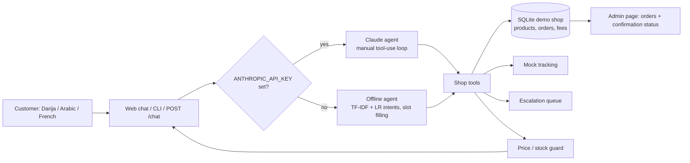

<p align="center"></p>

# dzshop-agent

An AI customer-service and order agent for small Algerian e-commerce shops: it answers in Darija, Arabic or French, takes and confirms cash-on-delivery (COD) orders, tracks deliveries, and hands over to a human when needed.

It is a personal portfolio project built against a **mock backend** (SQLite, invented demo shop, demo shipping fees). It is not connected to any real shop, carrier, WhatsApp or Messenger account.

## Problem this solves

Most small Algerian online shops sell on Facebook/Instagram and get paid in cash on delivery. Customers write in Darija (often Latin script with numerals, such as `slm, ch7al soum?`), Arabic or French. Shop owners spend hours answering the same questions (price, stock, delivery to my wilaya), and lose money on COD orders that are never confirmed or are refused at the door. This project shows an agent that handles the repetitive conversation, collects a *valid* order (Algerian phone format, known wilaya, real stock), asks the customer to confirm the total before anything ships, and escalates to a person when it should.

## Features

- Language handling: detects Darija-Latin / Arabic / French, normalises Arabizi numerals (3 -> ع, 7 -> ح, 9 -> ق, 5 -> خ ...) for matching, and replies in the customer's language.
- Mock SQLite backend: product catalog, customers, orders, shipping fees by wilaya (**demo values, not real carrier prices**), and a mock delivery-tracking service with simulated progress.
- Tools (unit-tested): `search_products`, `get_price_and_stock`, `quote_shipping`, `create_cod_order` (validates `05/06/07` + 8 digits), `confirm_order`, `cancel_order`, `get_order_status`, `track_shipment`, `escalate_to_human` (with reason).
- Price/stock guard: tools never accept prices, and every amount or stock figure in a reply must have come from a tool result in the same turn; otherwise the reply is blocked and the conversation is escalated.
- Privacy: order status and tracking require the phone number used for the order.
- Two agents behind one interface:
  - **Claude agent**: official `anthropic` SDK, model `claude-opus-5-5`, manual tool-use loop, shop-policy system prompt, per-customer conversation memory.
  - **Offline agent** (used automatically when `ANTHROPIC_API_KEY` is not set, and by all tests): TF-IDF + logistic regression intent classifier trained on small hand-written multilingual examples, slot-filling order flow, templated replies in three languages, calling the same tools.
- Interfaces: FastAPI `/chat`, mobile-friendly Messenger-style web chat (`/`), admin page with orders and confirmation status (`/admin`), CLI chat.

## Quick start

```bash
python -m venv .venv && source .venv/bin/activate      # Windows: .venv\Scripts\activate
pip install -e ".[dev]"
pytest -q                                              # offline, a few seconds
python -m dzshop.demo                                  # scripted Darija conversation (offline)
python -m dzshop.cli                                   # interactive chat
uvicorn dzshop.api:create_app --factory --port 8000    # web UI at http://localhost:8000 , admin at /admin
```

To use Claude instead of the offline agent: `export ANTHROPIC_API_KEY=...` before starting the CLI or server. `GET /health` reports the active mode (`offline` or `claude`).

Docker: `docker build -t dzshop-agent . && docker run -p 8000:8000 dzshop-agent`.

API example: `curl -X POST localhost:8000/chat -H 'content-type: application/json' -d '{"customer_id":"c1","message":"slm, ch7al soum?"}'` returns `reply`, `language`, `mode`, `escalated` and the list of `tool_calls`.

## Example conversation (real output, offline mode)

Generated by `python -m dzshop.demo` (Darija in Latin script; `[tools: ...]` lines show the tool calls made that turn):

```text
Customer: slm
Agent   : Salam! Merhba bik fi Boutique Démo Dzair (DEMO). N9der n3awnek f: les prix, la commande (paiement 3and l'istilam), livraison w suivi t3 commande. Chno t7eb?

Customer: ch7al soum la montre?
Agent   : Montre connectée Nova: 6 500 DA. Kayn 14 pièces en stock. T7eb dir commande (paiement 3and l'istilam)?
          [tools: search_products, get_price_and_stock]

Customer: n7eb ncommandi 2
Agent   : Mzyan! 2 × Montre connectée Nova. L ina wilaya nwasslou?
          [tools: search_products, get_price_and_stock]

Customer: Oran
Agent   : Livraison l Oran: 600 DA (valeur démo), 7oudoud 3 ayam.
Chno smiytek (l'ism w l-la9ab)?
          [tools: get_price_and_stock, quote_shipping]

Customer: Karim Benali
Agent   : Merci Karim. Rani 7tajlek numéro t3 telephone (ex: 0661234567) bach nconfirmiw m3ak.
          [tools: get_price_and_stock]

Customer: 0661 23 45 67
Agent   : Mzyan. Chno l'3enwan complet t3 livraison (cité, rue, commune)?
          [tools: get_price_and_stock]

Customer: Cité 500 logements, Es Senia
Agent   : Commande DZ-1003 (en attente de confirmation):
- 2 × Montre connectée Nova = 13 000 DA
Livraison Oran: 600 DA
Total a payer 3and l'istilam: 13 600 DA
Kteb "iyeh" bach nconfirmiw la commande.
          [tools: get_price_and_stock, create_cod_order]

Customer: iyeh confirmi
Agent   : Commande DZ-1003 confirmée! Total 13 600 DA 3and l'istilam. Code de suivi: DZT579631. Tweslek f 7oudoud 3 ayam. Saha!
          [tools: confirm_order]

Customer: win wsslet commande?
Agent   : Commande DZ-1003: tsejjlat l'expédition — Entrepôt démo - Alger. Total 13 600 DA 3and l'istilam. Code: DZT579631.
          [tools: track_shipment]
```

The same agent answering in Arabic (also real offline output):

```text
Customer: بشحال الساعة؟
Agent   : ساعة ذكية نوفا: 6 500 دج. عندنا 14 قطعة متوفرة. تحب نسجل لك طلب (الدفع عند الاستلام)؟

Customer: كم التوصيل لوهران
Agent   : التوصيل إلى وهران: 600 دج (قيمة تجريبية)، خلال حوالي 3 أيام.
```

## How it works



1. `lang.py` detects the script/language and normalises text (accents, Arabic letter variants, Arabizi numerals) so `ch7al`, `chhal` and `بشحال` match the same intents and products.
2. The agent calls tools. The Claude agent runs the manual loop (`stop_reason == "tool_use"` -> run every tool block -> one user message of `tool_result` blocks); the offline agent follows a deterministic flow: intent -> product/wilaya/phone extraction -> slot filling -> `create_cod_order` -> customer confirms -> `confirm_order` (stock is reserved and a mock shipment created).
3. `guard.py` compares every amount and stock number in the final reply to the tool results of that turn.

## Project structure

```text
dzshop/
  db.py            SQLite schema + demo seed (catalog, fees, sample orders)
  lang.py          language detection, Arabizi normalisation
  tools.py         the tools + JSON schemas for Claude + phone/wilaya helpers
  tracking.py      mock delivery-tracking service
  guard.py         price/stock guard
  intents.py       offline intent classifier (hand-written examples)
  offline.py       offline agent (slot filling, routing)
  templates.py     Darija / Arabic / French reply templates
  claude_agent.py  Claude agent (anthropic SDK, manual tool loop) + build_agent()
  session.py       per-customer memory
  api.py, cli.py, demo.py, static/{index,admin}.html
tests/             pytest, fully offline
```

## Tests

`pytest -q` covers language detection, Arabizi normalisation, phone validation, every tool (including rejections), the price guard, an end-to-end Darija conversation (greeting -> price -> order -> confirmation -> tracking) asserting the exact tool calls, French and Arabic flows, escalation, the FastAPI endpoints, and the Claude tool-use loop against a scripted fake client (no network, no key).

## Limitations

- Demo data only: the catalog, wilayas (11 of 58) and shipping fees are invented sample values, not real carrier prices.
- The Claude agent's tool loop is tested against a fake client; its behaviour with the live API has not been evaluated here.
- The offline classifier is trained on a few hundred hand-written phrases; it handles common phrasings and typos, not free-form Darija. Unknown input asks to rephrase, then escalates.
- Conversation memory is in-process and the admin page has no login.
- Confirmation happens in chat; there is no outbound call/SMS confirmation yet.
- DZD only, one product per order in the offline agent, COD only.
- **No real WhatsApp or Messenger/Instagram integration yet** (see roadmap).

## Roadmap

- WhatsApp Business and Messenger/Instagram webhook adapters.
- Admin authentication; outbound SMS/call confirmation for unconfirmed COD orders.
- Real carrier APIs in place of the mock tracking service; full 58-wilaya fee table.
- Evaluation set of anonymised real Darija conversations; Arabic-script Darija intent data.

## License

MIT (c) 2026 Nidhal Kissoum
